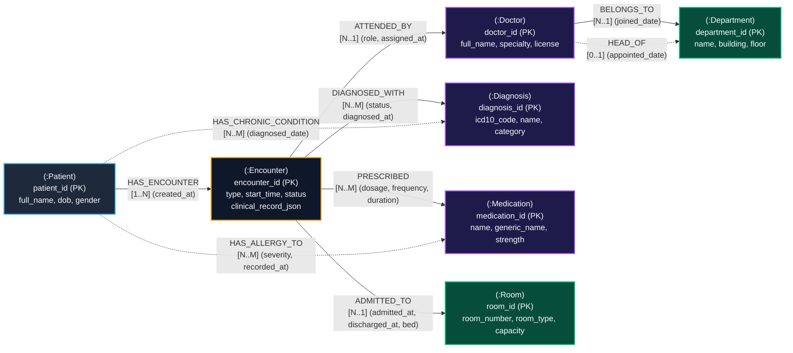

# Database Design Specification: Hybrid Multi-Model NoSQL for Smart Hospitals

> **Course / Academic Module**: BCSE406 NoSQL Databases — Capstone Project  
> **System Architecture**: Hybrid Graph-Document NoSQL Platform  
> **Core Technologies**: Neo4j AuraDB (Property Graph + Cypher) & Embedded JSON Document Store

---

## 1. Executive Summary & Architecture Overview

Modern hospital information systems require handling two distinct classes of clinical data:
1. **High-Connectivity Operational Networks**: Entities like Patients, Attending Doctors, Medical Specialties/Departments, Inpatient Rooms, and Encounters form an intricate, multi-dimensional web of relationships. Traditional Relational Database Management Systems (RDBMS) struggle with recursive traversals (e.g., patient transfer trails, infection contact tracing, multi-disciplinary consultations), requiring multiple self-joins and recursive Common Table Expressions ($O(N^k)$ complexity).
2. **Dynamic Semi-Structured Clinical Records**: Medical observations, triage vitals, episodic nursing notes, and specialty-specific lab panels vary drastically between patient visits. Attempting to fit these into strict SQL schemas leads to bloated tables with hundreds of nullable columns or expensive Entity-Attribute-Value (EAV) antipatterns.

### The Hybrid Multi-Model Solution
This project synthesizes **Native Graph Modeling** with **Document Storage**:
- **Graph Layer (Neo4j Property Graph)**: Explicitly represents entities as labeled nodes (`Patient`, `Doctor`, `Department`, `Encounter`, `Diagnosis`, `Medication`, `Room`) and their interactions as typed, directed relationships (`HAS_ENCOUNTER`, `ATTENDED_BY`, `BELONGS_TO`, `DIAGNOSED_WITH`, `PRESCRIBED`, `ADMITTED_TO`, `HAS_ALLERGY_TO`, `HEAD_OF`). Graph edges utilize **Index-Free Adjacency**, allowing constant-time $O(1)$ relationship traversal regardless of database size.
- **Document Layer (Embedded JSON Payloads)**: Each `Encounter` node carries a validated, structured JSON document (`clinical_record_json`). This payload embeds episodic vital signs, longitudinal nursing notes, lab test panels, and discharge instructions without imposing rigid column constraints across disparate departments.

---

## 2. Graph Schema Architecture & Mermaid Diagram



---

## 3. Node Specifications & Property Data Types

### 3.1 Node Label: `Patient`
Represents an individual receiving medical evaluation or treatment.

| Property | Data Type | Constraint / Validation | Description |
| :--- | :--- | :--- | :--- |
| `patient_id` | String | **UNIQUE (PK)**, e.g., `P1001` | Unique internal institutional identifier |
| `first_name` | String | Required, 1-50 chars | Patient given name |
| `last_name` | String | Required, 1-50 chars | Patient family name |
| `dob` | Date / String | ISO-8601 `YYYY-MM-DD` | Date of birth |
| `gender` | String | Enum (`Male`, `Female`, `Other`) | Administrative gender |
| `blood_group` | String | Enum (`A+`, `A-`, `B+`, `B-`, `AB+`, `AB-`, `O+`, `O-`) | ABO and Rh blood classification |
| `contact_phone` | String | E.164 or local format | Primary telephone contact |
| `emergency_contact` | String | Free-text / phone | Name and telephone of primary emergency contact |
| `created_at` | DateTime | ISO-8601 UTC timestamp | Record creation timestamp |

### 3.2 Node Label: `Doctor`
Represents a licensed physician or medical consultant.

| Property | Data Type | Constraint / Validation | Description |
| :--- | :--- | :--- | :--- |
| `doctor_id` | String | **UNIQUE (PK)**, e.g., `DOC201` | Unique physician identifier |
| `first_name` | String | Required | Physician given name |
| `last_name` | String | Required | Physician family name |
| `specialty` | String | Required (e.g., `Cardiology`, `Neurology`) | Primary clinical specialization |
| `license_number` | String | Unique string format | State or national medical license registration |
| `email` | String | Standard email format | Professional hospital email |
| `phone` | String | Standard telephone | Departmental contact extension |
| `years_of_experience`| Integer| Non-negative integer | Clinical practice tenure |

### 3.3 Node Label: `Department`
Represents a clinical, surgical, or operational division.

| Property | Data Type | Constraint / Validation | Description |
| :--- | :--- | :--- | :--- |
| `department_id` | String | **UNIQUE (PK)**, e.g., `DEP01` | Unique department code |
| `name` | String | Required, e.g., `Cardiology` | Full division name |
| `building` | String | e.g., `Block A`, `Main Wing` | Physical campus building |
| `floor` | Integer | Integer (-2 to 20) | Facility floor level |
| `phone_extension` | String | e.g., `x4011` | Intercom extension |

### 3.4 Node Label: `Encounter`
Represents a discrete clinical interaction (Inpatient Admission, Outpatient Consultation, Emergency Triage).

| Property | Data Type | Constraint / Validation | Description |
| :--- | :--- | :--- | :--- |
| `encounter_id` | String | **UNIQUE (PK)**, e.g., `ENC5001` | Unique clinical encounter event identifier |
| `encounter_type` | String | Enum (`Inpatient`, `Outpatient`, `Emergency`) | Setting of care delivery |
| `status` | String | Enum (`Active`, `Discharged`, `Transferred`, `Completed`) | Current operational status |
| `start_time` | DateTime | ISO-8601 UTC | Timestamp when encounter commenced |
| `end_time` | DateTime | ISO-8601 UTC (Nullable) | Timestamp when encounter terminated / discharge |
| `reason_for_visit` | String | Free text | Chief complaint or admission reason |
| `clinical_record_json`| String / JSON| Valid JSON document | Embedded document containing vitals, labs, notes |

### 3.5 Node Label: `Diagnosis`
Represents an identified medical condition, syndrome, or pathology.

| Property | Data Type | Constraint / Validation | Description |
| :--- | :--- | :--- | :--- |
| `diagnosis_id` | String | **UNIQUE (PK)**, e.g., `DIAG301` | Master diagnosis catalog identifier |
| `icd10_code` | String | Required, e.g., `I21.9`, `E11.9` | World Health Organization ICD-10 clinical code |
| `name` | String | Required, e.g., `Acute Myocardial Infarction` | Standard diagnostic name |
| `category` | String | e.g., `Cardiovascular`, `Endocrine` | Medical subspecialty taxonomy |
| `severity_typical` | String | Enum (`Mild`, `Moderate`, `Severe`, `Critical`) | Expected clinical acuity |

### 3.6 Node Label: `Medication`
Represents a pharmaceutical drug or therapeutic agent.

| Property | Data Type | Constraint / Validation | Description |
| :--- | :--- | :--- | :--- |
| `medication_id` | String | **UNIQUE (PK)**, e.g., `MED401` | Unique pharmaceutical catalog ID |
| `name` | String | Required, e.g., `Atorvastatin` | Brand or proprietary trade name |
| `generic_name` | String | Required, e.g., `Atorvastatin Calcium` | International Nonproprietary Name (INN) |
| `dosage_form` | String | Enum (`Tablet`, `Injection`, `Infusion`, `Inhaler`) | Physical drug presentation |
| `standard_strength`| String | e.g., `20mg`, `500mg/100mL` | Reference unit concentration |

### 3.7 Node Label: `Room`
Represents an inpatient room or clinical bed location.

| Property | Data Type | Constraint / Validation | Description |
| :--- | :--- | :--- | :--- |
| `room_id` | String | **UNIQUE (PK)**, e.g., `RM102` | Physical room code |
| `room_number` | String | e.g., `102-A` | Public-facing room signage number |
| `room_type` | String | Enum (`ICU`, `General Ward`, `Private`, `Isolation`) | Care acuity classification |
| `capacity` | Integer | Positive integer (e.g., 1, 2, 4) | Maximum simultaneous bed spaces |
| `floor` | Integer | Integer | Floor location |

---

## 4. Relationship Semantics & Cardinality

| Relationship Type | Source Node | Target Node | Cardinality | Direction Semantics | Properties |
| :--- | :--- | :--- | :--- | :--- | :--- |
| `HAS_ENCOUNTER` | `Patient` | `Encounter` | $1 \to N$ | A patient initiates one or more clinical encounters over time. | `created_at` (DateTime) |
| `ATTENDED_BY` | `Encounter` | `Doctor` | $N \to 1$ | An encounter is overseen by an attending physician. | `role` (String: `Attending`, `Consultant`), `assigned_at` (DateTime) |
| `BELONGS_TO` | `Doctor` | `Department` | $N \to 1$ | A physician belongs to an administrative medical specialty. | `joined_date` (Date) |
| `HEAD_OF` | `Doctor` | `Department` | $0..1 \to 1$ | A senior physician serves as department chairperson/head. | `appointed_date` (Date) |
| `DIAGNOSED_WITH`| `Encounter` | `Diagnosis` | $N \to M$ | A clinical visit produces one or more verified diagnoses. | `status` (Enum: `Primary`, `Secondary`), `diagnosed_at` (DateTime), `notes` (String) |
| `PRESCRIBED` | `Encounter` | `Medication`| $N \to M$ | A physician issues a medication order during the encounter. | `dosage` (String), `frequency` (String), `duration_days` (Int), `instructions` (String) |
| `ADMITTED_TO` | `Encounter` | `Room` | $N \to 1$ | An inpatient encounter utilizes a specific bed and room space. | `admitted_at` (DateTime), `discharged_at` (DateTime, nullable), `bed_number` (String) |
| `HAS_ALLERGY_TO` | `Patient` | `Medication`| $N \to M$ | Patient exhibits an adverse immunologic reaction to a drug. | `severity` (Enum: `Mild`, `Severe`, `Anaphylactic`), `recorded_at` (DateTime) |
| `HAS_CHRONIC_CONDITION` | `Patient` | `Diagnosis` | $N \to M$ | Longitudinal pre-existing chronic conditions of patient. | `diagnosed_date` (Date) |

---

## 5. Document-Style JSON Model: `clinical_record_json`

To demonstrate multi-model capabilities without adding an external document database daemon, each `Encounter` node embeds a validated, structured JSON document inside its `clinical_record_json` property.

### 5.1 JSON Schema Specification
The document schema enforces:
1. `vital_signs`: Objective physiological indicators recorded at triage or regular monitoring intervals.
2. `clinical_notes`: Subjective history, objective physical exam observations, and clinical assessment plans.
3. `test_results`: Array of laboratory panels and diagnostic imaging findings.
4. `treatment_summary`: Procedures performed, nursing care interventions, and dietary restrictions.
5. `encounter_timestamps`: Fine-grained operational timeline milestones.

### 5.2 Valid Fictional JSON Example
```json
{
  "encounter_id": "ENC5001",
  "encounter_type": "Inpatient",
  "vital_signs": {
    "temperature_celsius": 38.4,
    "heart_rate_bpm": 104,
    "blood_pressure": {
      "systolic_mmhg": 138,
      "diastolic_mmhg": 88
    },
    "respiratory_rate_bpm": 22,
    "oxygen_saturation_percent": 94,
    "recorded_at": "2026-10-12T08:30:00Z"
  },
  "clinical_notes": {
    "chief_complaint": "Acute productive cough, dyspnea, and high-grade fever for 4 days.",
    "history_of_present_illness": "62-year-old fictional patient presenting with progressive shortness of breath. Crackles audible in right lower lung lobe.",
    "assessment_and_plan": "Community-acquired right lower lobe pneumonia. Initiating intravenous antibiotic therapy and supplemental oxygen via nasal cannula.",
    "discharge_summary": null
  },
  "test_results": [
    {
      "panel": "Complete Blood Count",
      "test_name": "White Blood Cell Count (WBC)",
      "value": 14.8,
      "unit": "10^3/uL",
      "reference_range": "4.5 - 11.0",
      "flag": "HIGH",
      "reported_at": "2026-10-12T10:15:00Z"
    },
    {
      "panel": "Inflammatory Markers",
      "test_name": "C-Reactive Protein (CRP)",
      "value": 48.2,
      "unit": "mg/L",
      "reference_range": "< 5.0",
      "flag": "CRITICAL_HIGH",
      "reported_at": "2026-10-12T10:45:00Z"
    },
    {
      "panel": "Radiology",
      "test_name": "Chest X-Ray (AP View)",
      "value": "Consolidation observed in right lower lobe consistent with lobar pneumonia. No pleural effusion.",
      "unit": "text",
      "reference_range": "Clear lung fields",
      "flag": "ABNORMAL",
      "reported_at": "2026-10-12T11:30:00Z"
    }
  ],
  "treatment_summary": {
    "oxygen_therapy": "Nasal cannula at 2 L/min",
    "dietary_order": "Standard diabetic cardiac diet",
    "activity_level": "Bed rest with bathroom privileges",
    "fall_risk": "Moderate"
  },
  "encounter_timestamps": {
    "triage_time": "2026-10-12T08:15:00Z",
    "physician_first_seen": "2026-10-12T08:45:00Z",
    "bed_assigned": "2026-10-12T09:30:00Z",
    "discharge_expected": "2026-10-18T12:00:00Z"
  }
}
```

### 5.3 Storage, Serialization & Parsing Architecture
- **In Python (FastAPI Backend)**: The document is modeled as a strongly typed Pydantic schema (`ClinicalRecord`). It provides runtime validation, default values, and JSON serialization (`model_dump_json()`).
- **In Neo4j**: Stored directly as a stringified JSON property on the `Encounter` node (`e.clinical_record_json`). When APOC is available, Cypher can dynamically access inner properties using `apoc.convert.fromJsonMap(e.clinical_record_json).vital_signs.heart_rate_bpm`.
- **Parsing**: Upon retrieval, the backend automatically deserializes the string into a nested JSON object before returning it to the REST client or Streamlit frontend.

---

## 6. Constraints and Indexing Rationale

### 6.1 Uniqueness Constraints (Cypher 5.x)
Uniqueness constraints guarantee data integrity and automatically construct underlying high-performance B-tree lookup indexes:
```cypher
CREATE CONSTRAINT constraint_patient_id IF NOT EXISTS FOR (p:Patient) REQUIRE p.patient_id IS UNIQUE;
CREATE CONSTRAINT constraint_doctor_id IF NOT EXISTS FOR (d:Doctor) REQUIRE d.doctor_id IS UNIQUE;
CREATE CONSTRAINT constraint_department_id IF NOT EXISTS FOR (dept:Department) REQUIRE dept.department_id IS UNIQUE;
CREATE CONSTRAINT constraint_encounter_id IF NOT EXISTS FOR (e:Encounter) REQUIRE e.encounter_id IS UNIQUE;
CREATE CONSTRAINT constraint_diagnosis_id IF NOT EXISTS FOR (diag:Diagnosis) REQUIRE diag.diagnosis_id IS UNIQUE;
CREATE CONSTRAINT constraint_medication_id IF NOT EXISTS FOR (m:Medication) REQUIRE m.medication_id IS UNIQUE;
CREATE CONSTRAINT constraint_room_id IF NOT EXISTS FOR (r:Room) REQUIRE r.room_id IS UNIQUE;
```

### 6.2 Property Search Indexes
Speed up frequent multi-attribute filters without incurring full-graph node scans:
```cypher
-- Rapid patient directory name searching (prefix & exact match)
CREATE INDEX idx_patient_names IF NOT EXISTS FOR (p:Patient) ON (p.last_name, p.first_name);

-- Temporal range queries on admission / encounter timelines
CREATE INDEX idx_encounter_start_time IF NOT EXISTS FOR (e:Encounter) ON (e.start_time);

-- Filtering physicians by specialty during clinical triage routing
CREATE INDEX idx_doctor_specialty IF NOT EXISTS FOR (d:Doctor) ON (d.specialty);

-- Rapid ICD-10 medical code lookups
CREATE INDEX idx_diagnosis_icd10 IF NOT EXISTS FOR (diag:Diagnosis) ON (diag.icd10_code);

-- Drug name matching for prescription intake and allergy cross-referencing
CREATE INDEX idx_medication_name IF NOT EXISTS FOR (m:Medication) ON (m.name);

-- Room availability and acuity matching (ICU vs General Ward)
CREATE INDEX idx_room_type IF NOT EXISTS FOR (r:Room) ON (r.room_type);
```

---

## 7. Example Cypher Queries for Clinical Analytics

### Query 1: Comprehensive Patient Clinical History & Care Network
Retrieves the longitudinal record of a patient including all past visits, attending physicians, specialty departments, confirmed diagnoses, and prescribed drugs:
```cypher
MATCH (p:Patient {patient_id: $patient_id})-[:HAS_ENCOUNTER]->(e:Encounter)
OPTIONAL MATCH (e)-[:ATTENDED_BY]->(doc:Doctor)-[:BELONGS_TO]->(dept:Department)
OPTIONAL MATCH (e)-[r_diag:DIAGNOSED_WITH]->(diag:Diagnosis)
OPTIONAL MATCH (e)-[r_med:PRESCRIBED]->(med:Medication)
OPTIONAL MATCH (e)-[r_room:ADMITTED_TO]->(rm:Room)
RETURN e.encounter_id AS encounter_id,
       e.encounter_type AS encounter_type,
       e.start_time AS visit_date,
       e.status AS status,
       doc.first_name + ' ' + doc.last_name AS attending_physician,
       dept.name AS department,
       collect(DISTINCT {code: diag.icd10_code, diagnosis: diag.name, status: r_diag.status}) AS diagnoses,
       collect(DISTINCT {medication: med.name, dosage: r_med.dosage, frequency: r_med.frequency}) AS prescriptions,
       rm.room_number AS room_allocated,
       e.clinical_record_json AS clinical_record
ORDER BY e.start_time DESC;
```

### Query 2: Longitudinal Care Pathway Traversal
Traces the sequential journey of a patient across emergency triage, specialist consultations, surgical/ICU transfers, and discharge:
```cypher
MATCH path = (p:Patient {patient_id: $patient_id})-[:HAS_ENCOUNTER]->(e:Encounter)
OPTIONAL MATCH (e)-[:ATTENDED_BY]->(d:Doctor)
OPTIONAL MATCH (e)-[:ADMITTED_TO]->(r:Room)
WITH e, d, r ORDER BY e.start_time ASC
RETURN collect({
    encounter_id: e.encounter_id,
    type: e.encounter_type,
    time: e.start_time,
    doctor: d.first_name + ' ' + d.last_name,
    specialty: d.specialty,
    room: r.room_number,
    reason: e.reason_for_visit
}) AS patient_pathway;
```

### Query 3: Cross-Infection Contact Tracing / Room-Sharing Analysis
Identifies all patients who occupied the same room simultaneously or sequentially with an index patient within an exposure window (crucial for epidemiological infection control):
```cypher
MATCH (source_p:Patient {patient_id: $index_patient_id})-[:HAS_ENCOUNTER]->(source_e:Encounter)-[source_adm:ADMITTED_TO]->(shared_room:Room)
MATCH (contact_e:Encounter)-[contact_adm:ADMITTED_TO]->(shared_room)
MATCH (contact_p:Patient)-[:HAS_ENCOUNTER]->(contact_e)
WHERE contact_p <> source_p
  AND contact_adm.admitted_at <= coalesce(source_adm.discharged_at, datetime().epochMillis)
  AND coalesce(contact_adm.discharged_at, datetime().epochMillis) >= source_adm.admitted_at
RETURN contact_p.patient_id AS exposed_patient_id,
       contact_p.first_name + ' ' + contact_p.last_name AS exposed_patient_name,
       shared_room.room_number AS shared_room,
       shared_room.room_type AS room_type,
       source_adm.admitted_at AS index_admitted,
       source_adm.discharged_at AS index_discharged,
       contact_adm.admitted_at AS contact_admitted,
       contact_adm.discharged_at AS contact_discharged
ORDER BY contact_adm.admitted_at DESC;
```

### Query 4: Department Workload, Referral Flow & Bed Utilization
Calculates departmental admission volumes, active inpatient counts, and room occupancy rates:
```cypher
MATCH (dept:Department)<-[:BELONGS_TO]-(doc:Doctor)<-[:ATTENDED_BY]-(e:Encounter)
WHERE e.status = 'Active'
OPTIONAL MATCH (e)-[:ADMITTED_TO]->(rm:Room)
RETURN dept.name AS department_name,
       count(DISTINCT doc) AS active_physicians,
       count(DISTINCT e) AS active_encounters,
       count(DISTINCT rm) AS occupied_rooms
ORDER BY active_encounters DESC;
```

---

## 8. Database Model Comparative Evaluation

| Evaluation Dimension | Relational Database (RDBMS: PostgreSQL / MySQL) | Native Graph Database (Neo4j Property Graph) | Pure Document Database (MongoDB / CouchDB) | **Hybrid Multi-Model (This Project)** |
| :--- | :--- | :--- | :--- | :--- |
| **Data Topology** | Tabular relations with foreign key constraints | Nodes and first-class directed relationships | Hierarchical BSON/JSON documents | **Graph topology + Embedded JSON documents** |
| **Relationship Traversal** | Recursive SQL joins / CTEs ($O(N^k)$ complexity) | **Index-Free Adjacency ($O(1)$ per hop)** | Application-side aggregation `$lookup` | **Native $O(1)$ graph traversal** |
| **Clinical Record Flexibility**| Rigid schema; extensive nullable columns / EAV | Graph properties can hold schema-free data | Completely schema-agnostic documents | **Flexible episodic clinical JSON on nodes** |
| **Contact Tracing Efficiency** | Poor (requires Cartesian product self-joins) | **Exceptional (native Cypher pattern matching)**| Very slow across multiple collections | **Exceptional via graph traversal** |
| **Referential Integrity** | Strong ACID foreign key cascades | Strong ACID node-level constraints | Weak / application-managed references | **Strong graph constraints + validated JSON** |

---

## 9. Academic Review & Compliance Alignment

1. **Review 1 (Design & Research)**:
   - Defensible hybrid architecture solving relational traversal bottlenecks.
   - Comprehensive Mermaid entity graph diagrams and property specifications.
   - Idempotent schema initialization scripts enforcing strict uniqueness constraints.
2. **Review 2 (Working Prototype)**:
   - Validated Pydantic models mapping to both graph entities and embedded documents.
   - Working Cypher query templates prepared for integration into the FastAPI backend.
3. **Review 3 (Evaluation & Demonstration)**:
   - Query latency benchmark anchors utilizing Cypher summary timings (`result_available_after`).
   - Epidemic contact tracing and care pathway graph analytics ready for demonstration.

---

## 10. Privacy, Ethics & Synthetic Data Policy

- **Strictly Synthetic Data**: In strict accordance with healthcare information governance (HIPAA, GDPR, DISHA), no Protected Health Information (PHI) or real clinical records are ever collected, processed, or persisted.
- **Fictional Patient Personas**: All patient names, identification numbers, addresses, and medical charts are procedurally synthesized for academic demonstration purposes only.
- **Non-Clinical Disclaimer**: This application is an educational prototype and must never be utilized for real clinical decision-making or medical diagnosis.
