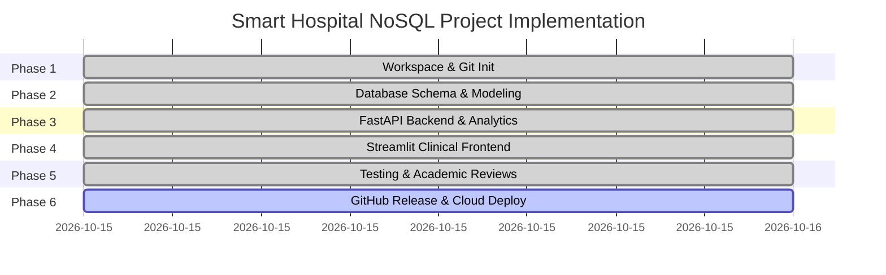

# Implementation Roadmap: Hybrid Multi-Model NoSQL Database for Smart Hospitals

This document outlines the six systematic phases required to deliver a complete, academic-grade, publicly hosted Smart Hospital Management System backed by Neo4j AuraDB, FastAPI, and Streamlit.

---

## 📅 Six-Phase Implementation Roadmap

---

### Phase 1: Workspace and Git Initialization `[COMPLETED]`
- **Objective**: Establish the isolated repository workspace and security baseline.
- **Deliverables**:
  - [x] Dedicated project directory created at `C:\Users\arunb\.gemini\antigravity-ide\scratch\Hybrid-Multi-Model-NoSQL-Database-for-Smart-Hospitals`.
  - [x] Git repository initialized with default branch `main`.
  - [x] Remote `origin` linked to official repository: `https://github.com/arunbala009/Hybrid-Multi-Model-NoSQL-Database-for-Smart-Hospitals.git`.
  - [x] Directory structure assembled (`backend/app`, `frontend`, `docs`, `scripts`, `.streamlit`).
  - [x] Robust `.gitignore` preventing accidental leaks of `.env`, `.venv`, and Streamlit secrets.
  - [x] Safe `.env.example` with placeholder credentials only.
  - [x] Foundational `README.md` and `docs/IMPLEMENTATION_PLAN.md`.
- **Exit Criteria**: Clean working tree, remote verified, secret exclusion verified.

---

### Phase 2: Database Schema & Hybrid Multi-Model Design `[COMPLETED]`
- **Objective**: Design and enforce the hybrid NoSQL schema in Neo4j AuraDB without touching legacy labels prematurely.
- **Deliverables**:
  - [x] Schema definition script (`scripts/init_schema.py`) enforcing 7 uniqueness constraints and 6 search indexes with idempotent dry-run default.
  - [x] `docs/DATABASE_DESIGN.md`: Complete graph schema, Mermaid diagrams, Cypher queries, and RDBMS vs NoSQL comparison.
  - [x] `backend/tests/test_schema_design.py`: 11 static schema validation tests passing.
- **Exit Criteria**: Schema verified via Cypher syntax checks and test suite.

---

### Phase 3: FastAPI Backend & Clinical Analytics Services `[COMPLETED]`
- **Objective**: Build a high-performance, modular asynchronous REST API.
- **Deliverables**:
  - [x] Modular FastAPI backend under `backend/app/` (`config.py`, `database.py`, `main.py`).
  - [x] Pydantic models under `backend/app/models/` (`patient.py`, `doctor.py`, `department.py`, `room.py`, `encounter.py`).
  - [x] Routers under `backend/app/routers/` (`health.py`, `patients.py`, `doctors.py`, `departments.py`, `rooms.py`, `encounters.py`, `analytics.py`, `demo.py`).
  - [x] Services under `backend/app/services/` with safe deletion checks and deterministic seeder.
  - [x] 40 automated offline tests passing in `backend/tests/`.
- **Exit Criteria**: All REST endpoints verified via unit tests and OpenAPI specs.

---

### Phase 4: Streamlit Hospital Intelligence Frontend `[COMPLETED]`
- **Objective**: Develop an interactive, responsive medical operations dashboard.
- **Deliverables**:
  - [x] Streamlit application entry point `frontend/app.py` with custom hospital styling (`.streamlit/config.toml`).
  - [x] Decoupled HTTP API client `frontend/api_client.py` with timeouts and error trapping.
  - [x] 8 view components under `frontend/components/`:
    - Overview, Patients, Doctors & Depts, Encounters & Charting, Rooms, Graph Explorer (Plotly/NetworkX), Hospital Analytics, and Demo Seeder.
  - [x] 20 automated offline frontend client tests (`frontend/tests/test_api_client.py`).
- **Exit Criteria**: Fully interactive web dashboard running locally.

---

### Phase 5: Automated Testing & Academic Review Deliverables `[COMPLETED]`
- **Objective**: Provide automated validation and comprehensive documentation mapped to academic evaluation milestones.
- **Deliverables**:
  - [x] 65 automated tests passing cleanly offline (0 live database writes).
  - [x] `backend/tests/test_integration_workflows.py`: 5 multi-step clinical integration tests.
  - [x] Academic Review Deliverables under `docs/reviews/`:
    - [x] `docs/reviews/REVIEW_1_DESIGN_AND_ARCHITECTURE.md`: Problem statement, literature review, hybrid NoSQL rationale, schema architecture, and RDBMS vs Graph comparison.
    - [x] `docs/reviews/REVIEW_2_WORKING_PROTOTYPE.md`: Complete API catalog, frontend modules, testing evidence, startup steps, and demonstration checklist.
    - [x] `docs/reviews/REVIEW_3_FINAL_EVALUATION.md`: Final architecture, evaluation methodology, complexity comparison, limitations, deployment readiness, and future research.
    - [x] `docs/reviews/USER_MANUAL.md`: System setup, service execution, detailed navigation across all 8 views, CRUD workflows, and troubleshooting.
    - [x] `docs/reviews/VIVA_QUESTIONS.md`: 30 thoroughly answered, academically rigorous examination questions across 8 domains.
    - [x] `docs/reviews/EVALUATION_PLAN.md`: Measurable, reproducible experimental benchmark protocols.
- **Exit Criteria**: 100% passing test suite (65 tests) and complete academic review documents.

---

### Phase 6: GitHub Release & Public Cloud Deployment `[NEXT - AWAITING APPROVAL]`
    - `docs/REVIEW_2_PROTOTYPE.md`: Architecture diagrams, API catalog, CRUD demonstration walkthrough, and screenshot anchors.
    - `docs/REVIEW_3_EVALUATION.md`: Algorithm analysis, query performance benchmarks (`result_available_after` timings), scalability evaluation, and viva question bank.
- **Exit Criteria**: 100% passing test suite and complete academic review markdown documents.

---

### Phase 6: GitHub Release & Public Cloud Deployment
- **Objective**: Publish the repository to GitHub and deploy publicly accessible cloud instances.
- **Deliverables**:
  - Safe Git commit and push to `https://github.com/arunbala009/Hybrid-Multi-Model-NoSQL-Database-for-Smart-Hospitals.git` on branch `main`.
  - Backend deployment on **Render**:
    - `render.yaml` infrastructure-as-code specification.
    - Environment secrets configured safely via Render Dashboard (`NEO4J_URI`, `NEO4J_USERNAME`, `NEO4J_PASSWORD`).
  - Frontend deployment on **Streamlit Community Cloud**:
    - Repository linked, pointing to `frontend/app.py`.
    - Secrets configured (`BACKEND_URL`) pointing to live Render service.
  - Final verification of public URLs and end-to-end cloud smoke test.
- **Exit Criteria**: Live, publicly reachable URLs for both Backend API docs and Frontend Web Application.
