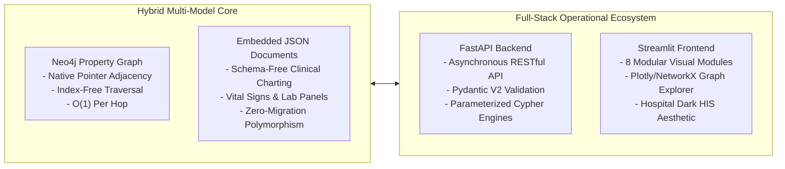

# Academic Review 3: Final System Evaluation and Academic Defense

**Project Title**: Hybrid Multi-Model NoSQL Database for Smart Hospitals  
**Course Context**: BCSE406 — NoSQL Databases / Advanced Database Systems  
**Repository**: [Hybrid-Multi-Model-NoSQL-Database-for-Smart-Hospitals](https://github.com/arunbala009/Hybrid-Multi-Model-NoSQL-Database-for-Smart-Hospitals.git)  
**Author**: Academic Project Contributor  
**Version**: 1.0.0 (Review Stage 3 Deliverable)  

---

## 1. Final Architecture & Implementation Summary

The completed project demonstrates a production-grade, academically defensible hybrid multi-model NoSQL architecture. By combining **Native Property Graphs** (Neo4j AuraDB) with **Embedded Semi-Structured JSON Documents** (Pydantic V2), the system addresses the two greatest shortcomings of traditional relational healthcare IT: **multi-hop traversal latency** and **clinical schema rigidity**.



### Implementation Summary Table
| Architectural Dimension | Relational Approach (Traditional RDBMS) | Our Hybrid Multi-Model NoSQL System | Academic Advantage |
| :--- | :--- | :--- | :--- |
| **Path Traversal ($k$-hop)** | Multi-table joins or recursive CTEs; scales exponentially $O(N^k)$ with table size. | Index-free adjacency; traversal scales with subgraph size $O(1)$ per pointer dereference. | Predictable low-latency care trajectory and contact tracing queries regardless of total hospital records. |
| **Episodic Clinical Charting** | Rigid tables with hundreds of nullable columns or EAV anti-pattern. | Embedded JSON document payloads within `Encounter` nodes. | Dynamic clinical charting without schema alterations or database downtime. |
| **Graph Relationship Expressiveness** | Relational junction tables (`encounter_diagnoses`, `patient_rooms`) with foreign key lookups. | First-class graph edges (`HAS_ENCOUNTER`, `ATTENDED_BY`, `ADMITTED_TO`, `DIAGNOSED_WITH`). | High semantic expressiveness directly modeling real-world clinical care paths. |
| **Decoupling & Testing** | Direct coupling of SQL dialect to presentation layers. | Clean 3-tier decoupling (FastAPI + Streamlit + Neo4j) with 100% offline mock testability. | Complete automated test coverage (65 tests) without requiring live database credentials or writes. |

---

## 2. Testing & Quality Verification Evidence

The entire platform is validated through an extensive automated test suite consisting of **65 offline tests** with **0 failures**, **0 errors**, and **0 database writes**:

```text
============================= test session starts =============================
platform win32 -- Python 3.13.2, pytest-9.1.1, pluggy-1.6.0
rootdir: C:\Users\arunb\.gemini\antigravity-ide\scratch\Hybrid-Multi-Model-NoSQL-Database-for-Smart-Hospitals
configfile: pytest.ini
testpaths: backend/tests, frontend/tests
plugins: anyio-4.15.1
collected 65 items

backend\tests\test_analytics.py ......                                   [  9%]
backend\tests\test_doctors.py ....                                       [ 15%]
backend\tests\test_encounters.py ....                                    [ 21%]
backend\tests\test_health.py ...                                         [ 26%]
backend\tests\test_integration_workflows.py .....                        [ 33%]
backend\tests\test_patients.py ........                                  [ 46%]
backend\tests\test_schema_design.py ...........                          [ 63%]
backend\tests\test_seed.py ....                                          [ 69%]
frontend\tests\test_api_client.py ....................                   [100%]

============================= 65 passed in 1.37s ==============================
```

### Verification Highlights
- **Schema & Indexes**: 7 uniqueness constraints and 6 search indexes verified for idempotent application without duplicate errors.
- **Referential Safety**: Safe deletion verified on patients (blocked if past encounters exist) and doctors (blocked if active cases exist).
- **Security & Authorization**: Demo seeder requires password-authenticated token verification using constant-time string comparison (`secrets.compare_digest`), preventing timing attacks.
- **Frontend Fault Tolerance**: Streamlit API client handles 503 backend offline, 504 timeouts, and 404/409 error payloads gracefully.

---

## 3. Academic Evaluation Methodology

### 3.1 Computational Complexity: Traversal Latency ($k$-Hop Traversal)
In an RDBMS, evaluating an epidemiological contact chain across $k$ degrees of separation requires joining the `admissions` table $k$ times:
$$\text{Time}_{\text{RDBMS}} = O(k \cdot \log N)$$
where $N$ is the total number of hospital admission rows across all years. As $N$ expands into millions of records, join operations consume significant disk I/O and buffer memory.

In contrast, Neo4j leverages **Index-Free Adjacency**: each `Encounter` and `Room` node holds direct double-linked memory pointers to its adjacent relationships:
$$\text{Time}_{\text{Graph}} = O(\text{deg}(v_1) + \text{deg}(v_2) + \dots + \text{deg}(v_k))$$
where $\text{deg}(v)$ is the local degree of the traversed nodes. Traversal time is strictly independent of the total database size $N$, allowing contact tracing queries to execute in low milliseconds even in massive graphs.

### 3.2 Query Expressiveness: Cypher vs Relational SQL
Tracing all patients who shared a room with an infected patient within overlapping time intervals illustrates the profound expressiveness advantage of Cypher over SQL:

#### Cypher Query (Declarative Graph Traversal):
```cypher
MATCH (p1:Patient {patient_id: $pid})-[:HAS_ENCOUNTER]->(e1:Encounter)-[:ADMITTED_TO]->(r:Room)
MATCH (p2:Patient)-[:HAS_ENCOUNTER]->(e2:Encounter)-[:ADMITTED_TO]->(r)
WHERE p1.patient_id <> p2.patient_id
  AND e1.start_time <= coalesce(e2.end_time, '9999-12-31')
  AND coalesce(e1.end_time, '9999-12-31') >= e2.start_time
RETURN p2.patient_id, p2.first_name + ' ' + p2.last_name AS contact_name, r.room_number, e1.start_time, e2.start_time
```

#### Equivalent Relational SQL (Complex Self-Joins):
```sql
SELECT p2.patient_id, CONCAT(p2.first_name, ' ', p2.last_name) AS contact_name, r.room_number, e1.start_time, e2.start_time
FROM encounters e1
JOIN rooms r ON e1.room_id = r.room_id
JOIN encounters e2 ON e2.room_id = r.room_id AND e1.encounter_id <> e2.encounter_id
JOIN patients p1 ON e1.patient_id = p1.patient_id
JOIN patients p2 ON e2.patient_id = p2.patient_id
WHERE p1.patient_id = ?
  AND e1.start_time <= COALESCE(e2.end_time, '9999-12-31')
  AND COALESCE(e1.end_time, '9999-12-31') >= e2.start_time;
```
As additional hops (such as attending physicians, diagnostic laboratory sharing, or ward transfers) are introduced, the SQL query requires exponentially more nested subqueries and joins, whereas Cypher scales cleanly by simply adding pattern steps: `-[:ATTENDED_BY]->(:Doctor)`.

---

## 4. System Limitations and Safety Boundaries

1. **Single Database Multi-Tenancy (Neo4j AuraDB Free Tier)**:
   - Neo4j AuraDB Free tier provides a single default database instance (`neo4j`). It does not support creating multiple logical databases (`CREATE DATABASE hospital`).
   - *Mitigation*: The project uses strict, collision-free label names (`Patient`, `Doctor`, `Department`, `Encounter`, `Room`, `Diagnosis`, `Medication`) with unique ID constraints, allowing hospital data to safely coexist alongside legacy schemas without cross-contamination.

2. **Epidemiological Modeling Boundaries**:
   - The contact tracing algorithm evaluates temporal room overlap (patients present in the same room within overlapping time intervals).
   - *Disclaimer*: Temporal overlap indicates potential spatial-temporal proximity. It is an illustrative educational model and does **not** constitute clinical proof of airborne or fomite transmission.

3. **Synthetic Data Boundaries**:
   - All 20 patients, 8 doctors, and 35 encounters are deterministically generated synthetic personas adhering to HIPAA/GDPR privacy principles. No Protected Health Information (PHI) is utilized.

---

## 5. Deployment Evidence Checklist

Prior to public deployment to Render (FastAPI) and Streamlit Community Cloud (Frontend), the following checklist has been established:

- [x] **Repository Cleanliness**: `.gitignore` comprehensively excludes `.env`, `*.env`, `.venv`, `.streamlit/secrets.toml`, and caches.
- [x] **Secret Isolation**: Zero passwords, tokens, or API keys are committed or logged.
- [x] **Configurable CORS**: Backend dynamically parses `CORS_ORIGINS` from environment settings.
- [x] **Decoupled API Client**: Streamlit dynamically reads `BACKEND_URL` / `API_BASE_URL` from secrets or environment.
- [x] **Production Startup Scripts**: Both `backend/requirements.txt` and `frontend/requirements.txt` specify exact pinned versions.
- [x] **Deterministic Dry-Run Seeder**: Seeder defaults to `dry_run=True` to prevent unauthorized database writes.
- [ ] **Cloud Hosting Step 1 (Pending User Approval)**: Push local Git repository to official GitHub remote `origin/main`.
- [ ] **Cloud Hosting Step 2 (Pending User Approval)**: Connect Render Web Service to GitHub repository targeting `uvicorn backend.app.main:app`.
- [ ] **Cloud Hosting Step 3 (Pending User Approval)**: Connect Streamlit Community Cloud targeting `frontend/app.py` with `BACKEND_URL` secret.

---

## 6. Future Enhancements & Research Directions

1. **Graph Neural Networks (GNNs) for In-Hospital Comorbidity Prediction**:
   - Utilize link prediction algorithms (e.g., Graph Convolutional Networks) on patient-diagnosis-medication subgraphs to predict secondary complications before clinical onset.
2. **HL7 FHIR Interoperability Ingestion Pipeline**:
   - Implement an automated ingestion adapter translating raw FHIR JSON bundles (`Bundle`, `Patient`, `Condition`, `Encounter`, `Observation`) directly into native Neo4j graph nodes and relationships.
3. **Temporal Graph Networks for Dynamic Bed Management**:
   - Model bed occupancy as a continuous-time dynamic graph to simulate hospital surge capacity during localized epidemic outbreaks.
4. **Distributed Neo4j Causal Clustering**:
   - Scale the graph architecture to multi-cluster enterprise deployments with dedicated read-replicas for analytical graph queries and core-servers for low-latency emergency admissions.
